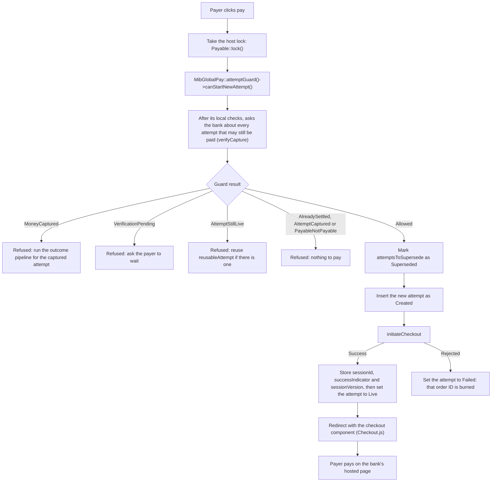
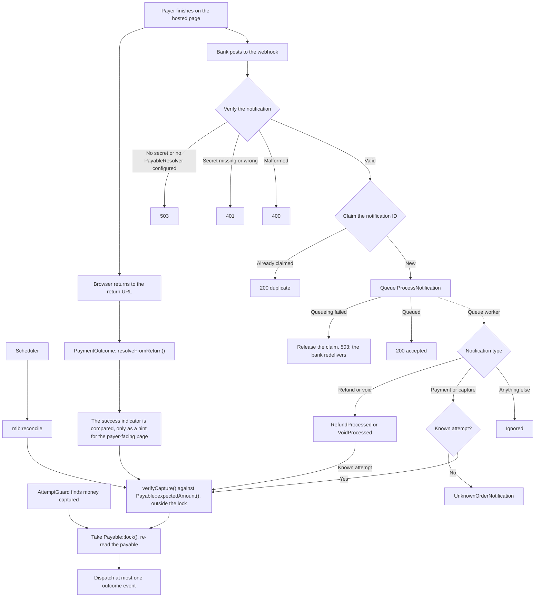

# Payment workflow (v2)

**A payment counts only when `verifyCapture()` confirms the exact amount and currency with the bank.**
The return URL, the webhook and `mib:reconcile` only trigger that check. The package never marks anything
paid: your listeners do that when they receive an event.

The diagrams show the optional Laravel layer. A non-Laravel host uses the same core classes (`AttemptGuard`,
`NotificationVerifier`, `verifyCapture()`) and writes this wiring itself.

## 1. Starting a checkout

One payable (your invoice or payment) can have several attempts. Each attempt has its own gateway order ID,
and an ID is never reused, even after a failure.

If the bank cannot be reached, the guard throws, so no new attempt starts while an older one might be paid.

## 2. Finding out what happened

Every trigger ends in the same pipeline.

The webhook answers within the bank's 2-second window because it only verifies, claims and queues. The bank
redelivers up to 20 times over 3 days. Schedule `mib:reconcile`, because it covers lost webhooks.

## 3. Outcome events

| `verifyCapture()` result | Payable | Event |
|---|---|---|
| `Captured` | Payable | `PaymentCaptured`: mark it paid and record the settlement |
| `Captured` | Settled by this same capture | None (duplicate) |
| `Captured` | Settled by another capture, or `Paid` with no settlement | `CaptureMismatch` (`DoubleCapture`) |
| `Captured` | Any other state | `PaymentCapturedForUnpayableOrder` |
| `AmountMismatch`, `CurrencyMismatch` | Any | `CaptureMismatch`: money moved but is wrong, so never auto-pay |
| `Pending` | Any | `PaymentPending` |
| `Reversed` | Any | `PaymentReversed` |
| `NotCaptured`, `NotFound` | Triggering transaction failed, or attempt expired | `PaymentFailed` |
| `NotCaptured`, `NotFound` | Attempt still live | None |

Each capture, mismatch or reversal produces its event once per order ID, transaction ID and outcome, however
many triggers arrive. `PaymentPending` and `PaymentFailed` have no such dedupe, so make their listeners
idempotent.

With `MIB_AUTO_REVERSE_DOUBLE_CAPTURE` on (off by default), a `DoubleCapture` also queues a reversal: a void,
falling back to a refund.

## Still unconfirmed by MIB

The `NotFound` mapping, the webhook body and header details and the production host are implemented but not yet
confirmed against the gateway. See the top of [DESIGN-v2.md](./DESIGN-v2.md).
